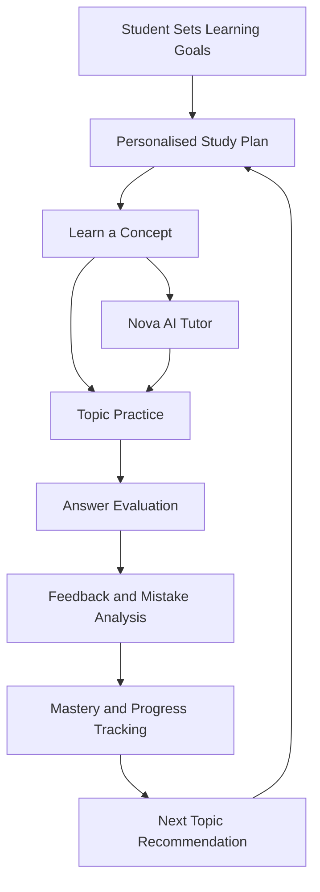
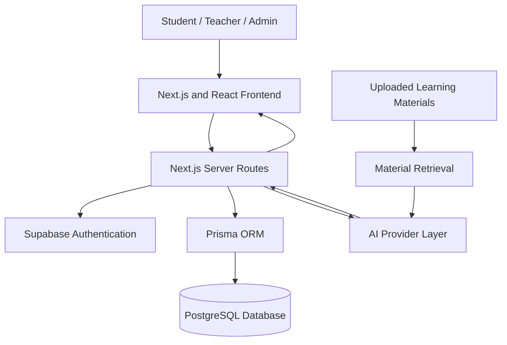

 <div align="center">

# 🎓 EduVanta

### Learn Smarter. Practise Better. Master More.

**An AI-powered learning platform designed to make learning personalised, adaptive, and measurable.**

[🌐 Website](https://edu-vanta.in) · [🚀 Live AI Tutor](https://eduvanta-eight.vercel.app/tutor)


</div>

---

## 📌 Table of Contents

- [About the Project](#-about-the-project)
- [The Problem](#-the-problem)
- [Our Solution](#-our-solution)
- [Key Features](#-key-features)
- [How EduVanta Works](#-how-eduvanta-works)
- [System Architecture](#-system-architecture)
- [Technology Stack](#-technology-stack)
- [Project Structure](#-project-structure)
- [How It Was Built](#-how-it-was-built)
- [Application Routes](#-application-routes)
- [Getting Started](#-getting-started)
- [Environment Configuration](#-environment-configuration)
- [Database Setup](#-database-setup)
- [Testing and Quality Checks](#-testing-and-quality-checks)
- [Security](#-security)
- [Deployment](#-deployment)
- [Future Scope](#-future-scope)
- [Founder](#-founder)

---

## 💡 About the Project

EduVanta is an AI-powered education platform built to help students understand concepts, practise effectively, identify weaknesses, and organise their preparation.

Traditional learning platforms often focus on delivering content and measuring test scores. EduVanta aims to connect the entire learning journey—from understanding a concept to reviewing mistakes and deciding what to study next.

The platform brings AI tutoring, adaptive practice, study planning, exam simulation, learning analytics, and mistake tracking into one integrated experience.

**Our vision:** Make personalised learning more accessible and help every learner make better use of their study time.

## 🎯 The Problem

Students frequently face challenges such as:

- Not knowing which topic to study next.
- Repeating mistakes without understanding the underlying concept.
- Receiving generic explanations that do not address their specific doubts.
- Following rigid study plans that do not adapt to progress.
- Preparing for exams without clear insights into topic-wise weaknesses.
- Using multiple disconnected tools for tutoring, practice, revision, and tracking.

## 🚀 Our Solution

EduVanta connects these activities through a continuous learning cycle.

| Challenge | EduVanta's approach |
|---|---|
| Difficulty understanding concepts | Nova AI Tutor |
| Inconsistent practice | Topic-based adaptive practice |
| Repeated mistakes | Mistake Vault and targeted revision |
| Unstructured preparation | Personalised study planner |
| Exam anxiety and weak feedback | Timed exam simulator and result analysis |
| Unclear learning progress | Mastery tracking and analytics |
| Classroom-wide learning gaps | Teacher dashboard and remedial practice |

The goal is not simply to provide answers. It is to help learners understand **what they know, what they need to improve, and what to do next.**

## ✨ Key Features

### 🧠 1. Nova AI Tutor

An AI-powered conversational tutor designed to help students understand concepts and resolve doubts.

- Context-aware tutoring and conversation history.
- Support for configured AI providers.
- Retrieval of relevant uploaded learning material when available.
- Usage quotas and rate limits.
- Error handling for failed AI requests.

### 🎯 2. Adaptive Practice

A practice experience designed to respond to student performance.

- Topic-based question practice.
- Adaptive difficulty where supported by the configured workflow.
- Server-side answer evaluation.
- Feedback after answer submission.
- Question generation with validation and fallback behaviour.
- Keyboard shortcuts for supported question flows.

### 📚 3. Learning Hub

A central place for course and topic learning.

- Course catalogue and enrolment.
- Topic lessons with explanations and examples.
- Connections between lessons and practice.
- PDF, TXT, and Markdown learning-material uploads.
- Text extraction, chunking, and relevant-content retrieval for supported files.

### 🗓️ 4. Personalised Study Planner

A structured approach to organising learning.

- Study goals, subjects, and availability.
- Topic prioritisation based on learning needs.
- Scheduled revision and study sessions.
- Missed-session rescheduling based on priority.

### 📝 5. Exam Simulator

A timed exam experience with progress tracking.

- Question navigation and mark-for-review.
- Server-stored answers and resumable attempts where configured.
- Timed submissions.
- Score and topic-wise breakdowns.
- Result analysis and identification of improvement areas.

### 🧩 6. Mistake Vault

A dedicated system for learning from errors.

- Tracks recurring mistakes.
- Groups mistakes by concept.
- Supports targeted revision and additional practice.
- Helps identify concepts that need more attention.

### 📈 7. Mastery and Learning Analytics

Progress indicators that go beyond a single test score.

- Topic-level performance.
- Accuracy and consistency signals.
- Revision and practice history.
- Recommendations for further learning.
- Exam-readiness indicators that help guide preparation but do not guarantee outcomes.

### 👩‍🏫 8. Teacher Dashboard

Tools to support classroom learning.

- Class-level topic insights.
- Assignment creation for authorised courses.
- Identification of commonly weak topics.
- Remedial practice workflows.

### 🛡️ 9. Admin and Platform Management

- Role-based access for students, teachers, and administrators.
- Administrative dashboards.
- User and content management.
- Payment review workflows.
- Selected audit records and system-health checks.

### 💳 10. Packages and Payments

- Package and premium-access workflows.
- UPI payment instructions where enabled.
- Manual transaction-reference verification.
- Administrative review before payment approval.

Payment verification should not be interpreted as automatic confirmation from a bank or payment gateway.

---

## 🔄 How EduVanta Works



### The learning cycle

1. **Set goals:** The learner identifies subjects, topics, and preparation targets.
2. **Learn:** Lessons and Nova provide explanations and contextual support.
3. **Practise:** The learner attempts topic-based questions.
4. **Review:** The platform evaluates responses and highlights mistakes.
5. **Measure:** Progress signals help identify stronger and weaker concepts.
6. **Adapt:** The learner uses recommendations and the planner to guide the next session.

---

## 🏗️ System Architecture



### Architecture principles

- **Frontend:** Presents the learning experience and collects user interactions.
- **Server routes:** Handle application workflows and validate requests.
- **Authentication:** Supabase manages user authentication and sessions.
- **Database:** PostgreSQL stores application data.
- **ORM:** Prisma provides typed database access and schema migrations.
- **AI integration:** A provider layer connects supported language models to tutoring and generation workflows.
- **Material retrieval:** Uploaded content can be processed into chunks and retrieved for relevant context.

Actual availability depends on the provider credentials, database configuration, and deployment environment.

## 🧰 Technology Stack

| Technology | Purpose |
|---|---|
| Next.js 14 | Application framework and routing |
| React 18 | User interface |
| TypeScript | Type-safe application development |
| Tailwind CSS | Styling |
| Supabase Auth | Authentication and sessions |
| PostgreSQL | Persistent application data |
| Prisma 5 | Database access and migrations |
| Anthropic API | AI capabilities when configured |
| OpenAI API | Supported AI workflows and embeddings |
| Gemini API | Supported AI workflows |
| Groq | Additional provider support where implemented |
| Zod | Input and structured-data validation |
| Recharts | Analytics visualisations |
| KaTeX | Mathematical notation |
| React Markdown | Markdown content rendering |
| Vitest | Automated testing |
| Vercel | Deployment platform |

## 📂 Project Structure

The following is a conceptual overview of the main application areas. Exact filenames may differ across repository versions.

```text
Eduvanta/
├── prisma/
│   ├── schema.prisma
│   └── migrations/
├── public/
├── src/
│   ├── app/
│   │   ├── api/
│   │   ├── admin/
│   │   ├── analytics/
│   │   ├── dashboard/
│   │   ├── exam/
│   │   ├── learn/
│   │   ├── materials/
│   │   ├── practice/
│   │   ├── tutor/
│   │   └── teacher/
│   ├── components/
│   ├── lib/
│   └── ...
├── tests/
├── .env.example
├── package.json
├── prisma/
└── README.md
```

**Note:** This diagram groups the principal areas of the application. Consult the actual repository tree for exact paths and filenames.

## 🛠️ How It Was Built

EduVanta is developed as a full-stack web application. Its major implementation stages are:

### Phase 1 — Product foundation

- Defined the learning problem and core user journeys.
- Organised the application around student, teacher, and admin experiences.
- Established the frontend, server, database, and authentication foundations.

### Phase 2 — Data and authentication

- Designed persistent application models in PostgreSQL.
- Used Prisma for database access and migrations.
- Integrated Supabase authentication.
- Added access checks for protected application areas.

### Phase 3 — AI integration

- Connected supported AI providers through application workflows.
- Added request validation, usage controls, and error handling.
- Developed tutoring and structured question-generation workflows.

### Phase 4 — Learning intelligence

- Connected practice attempts to feedback and learning records.
- Added mastery and mistake-tracking workflows.
- Built study-planning and exam-analysis features.

### Phase 5 — Platform experience

- Developed learner dashboards, teacher tools, admin workflows, and payment review.
- Added progress analytics and material retrieval.
- Prepared deployment configuration, security controls, and verification workflows.

These phases describe the implementation approach, not a claim that every feature is fully production-verified.

## 🗺️ Application Routes

| Route | Purpose |
|---|---|
| `/` | Landing and entry flow |
| `/onboarding` | Learner onboarding |
| `/dashboard` | Learning overview |
| `/learn` | Learning hub |
| `/learn/catalog` | Course catalogue |
| `/learn/[topicId]` | Topic lesson |
| `/practice` | Practice hub |
| `/practice/[topicId]` | Topic practice |
| `/tutor` | Nova AI Tutor |
| `/planner` | Study planner |
| `/exam/[examId]` | Exam experience |
| `/exam/result/[examAttemptId]` | Exam report |
| `/focus` | Focus Mode |
| `/mistakes` | Mistake Vault |
| `/materials` | Learning materials |
| `/analytics` | Learning analytics |
| `/profile` | Learner profile |
| `/packages` | Packages and payment flow |
| `/teacher` | Teacher dashboard |
| `/admin` | Admin dashboard |
| `/login` | Login |
| `/signup` | Registration |

These routes describe the intended application areas; route availability should be confirmed against the deployed version.

---

## 🚀 Getting Started

### Prerequisites

- Node.js 18.18 or newer.
- npm.
- PostgreSQL database.
- Supabase project.
- API key for at least one supported AI provider.

### 1. Clone the repository

```bash
git clone YOUR_REPOSITORY_URL
cd Eduvanta
```

Replace `YOUR_REPOSITORY_URL` with the actual Git repository URL.

### 2. Install dependencies

```bash
npm install
```

### 3. Configure environment variables

Copy the example file:

```bash
cp .env.example .env
```

On Windows PowerShell:

```powershell
Copy-Item .env.example .env
```

Populate the required values in `.env`. Never commit real credentials.

### 4. Generate Prisma Client

```bash
npx prisma generate
```

### 5. Apply database migrations

```bash
npx prisma migrate deploy
```

Use the appropriate development migration workflow for a fresh local database. Review migrations before applying them to production.

### 6. Start the application

```bash
npm run dev
```

Open [http://localhost:3000](http://localhost:3000).

---

## 🔐 Environment Configuration

Use `.env.example` as the authoritative list of variables supported by the current repository.

Common configuration includes:

| Variable | Purpose |
|---|---|
| `DATABASE_URL` | Application database connection |
| `DIRECT_URL` | Direct database connection where required |
| `NEXT_PUBLIC_SUPABASE_URL` | Supabase project URL |
| `NEXT_PUBLIC_SUPABASE_ANON_KEY` | Supabase public key |
| `AUTH_SECRET` | Application secret where required |
| `AI_PROVIDER` | Configured AI provider |
| `ANTHROPIC_API_KEY` | Anthropic API access |
| `OPENAI_API_KEY` | OpenAI and supported embedding workflows |
| `GEMINI_API_KEY` | Gemini API access |
| `GROQ_API_KEY` | Groq access where implemented |
| `CRON_SECRET` | Scheduled endpoint protection |
| `UPSTASH_REDIS_REST_URL` | Shared rate-limiting service |
| `UPSTASH_REDIS_REST_TOKEN` | Rate-limiting authentication |
| `NEXT_PUBLIC_EDUVANTA_UPI_ID` | UPI identifier for the payment flow |

Not every variable is mandatory for every deployment. Check `.env.example` and the deployment documentation.

## 🗄️ Database Setup

EduVanta uses PostgreSQL with Prisma-managed schema migrations.

Typical production preparation:

```bash
npx prisma generate
npx prisma migrate deploy
```

Before migrating a live database:

- Review pending migrations.
- Back up important data.
- Confirm database credentials and permissions.
- Verify any required PostgreSQL extensions.

**Never run `prisma migrate reset` on a production database.**

## 🧪 Testing and Quality Checks

Useful commands, if defined in the repository's `package.json`:

```bash
npm run lint
npm run typecheck
npm test
npm run build
```

If the repository provides a combined verification script:

```bash
npm run verify
```

Check `package.json` for the exact scripts available in your checkout.

## 🛡️ Security

EduVanta's security considerations include:

- Authentication for protected user experiences.
- Server-side authorisation and ownership checks.
- Request and structured-data validation.
- Rate limiting for supported AI operations.
- Controlled access to uploaded learning material.
- Server-side answer evaluation.
- Protected environment variables and API credentials.
- Auditing for selected sensitive administrative actions.

Before production deployment, verify the implementation and configuration of these controls.

AI-generated content may contain errors. Students should verify important academic information against trusted course materials.

## 🌍 Deployment

EduVanta can be deployed to Vercel or a compatible Node.js hosting environment.

Before release:

- Configure production environment variables.
- Set the correct authentication redirect URLs.
- Confirm database connectivity and migrations.
- Configure the selected AI provider.
- Configure shared rate limiting if required.
- Verify scheduled jobs and protected endpoints.
- Test authentication, tutoring, practice, exams, uploads, and role permissions.
- Inspect production logs and the configured health endpoint.

Live project: [edu-vanta.in](https://edu-vanta.in)

## 🔮 Future Scope

Potential directions for continued development include:

- More detailed learner-personalisation models.
- Additional curricula and question banks.
- Better explanations tailored to recurring misconceptions.
- Expanded educator analytics.
- More accessible multilingual learning experiences.
- Additional integrations for assessments and learning resources.

These are potential improvements, not promises of features that already exist.

## 👨‍💻 Founder

**Raghav Mittal**  
Founder and developer of EduVanta.

EduVanta is an early-stage project focused on making learning more personalised through AI, structured practice, and actionable feedback.

🌐 Website: [edu-vanta.in](https://edu-vanta.in)

---

<div align="center">

**EduVanta — A better way to understand what to learn next.**

*Built to make learning more personalised, structured, and measurable.*

</div>
